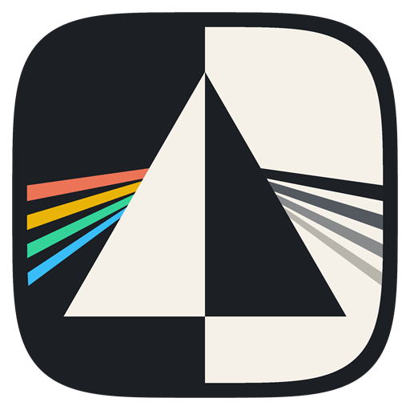
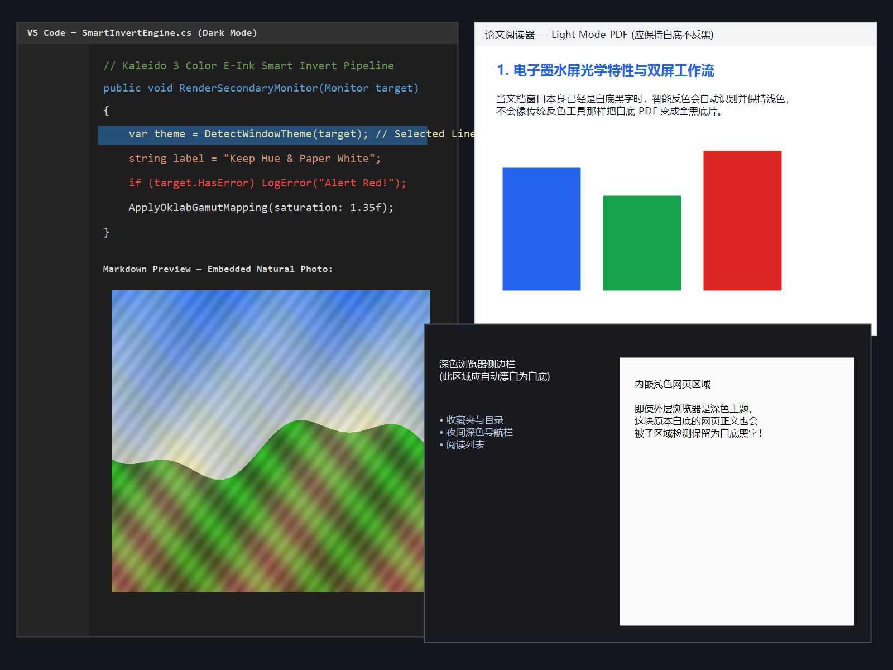
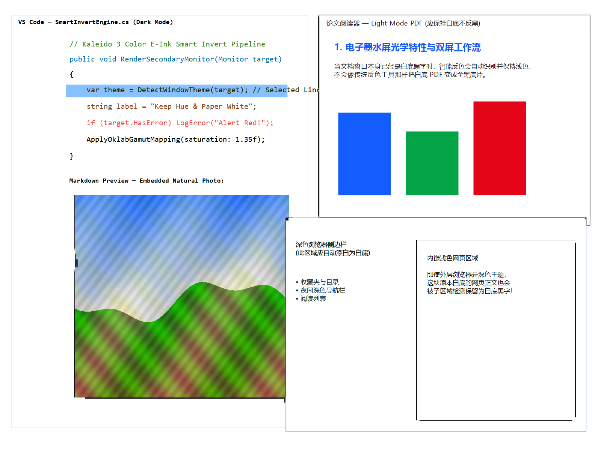
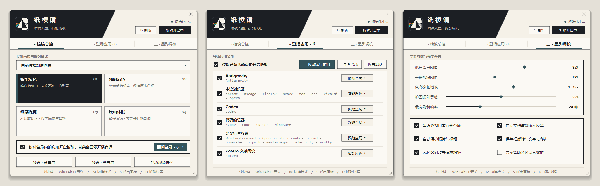
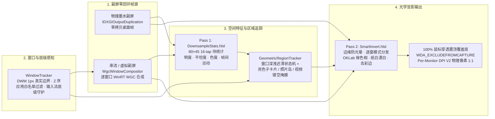

<div align="center">



# PaperPrism · 纸棱镜

**暗夜入墨，折射成纸**  
专为 Windows「深色主屏 + 彩色/黑白电子墨水副屏」打造的逐窗口 GPU 智能反色与纸感显影引擎

**简体中文** · [English](README_EN.md)

[](https://github.com/Zheng-QianChen/PaperPrism/releases)
[-1C1F24)](https://github.com/Zheng-QianChen/PaperPrism)
[](https://dotnet.microsoft.com/download/dotnet/9.0)
[](https://github.com/Zheng-QianChen/PaperPrism)
[](https://github.com/Zheng-QianChen/PaperPrism)
[](LICENSE)

</div>

---

## 为什么需要「纸棱镜」？

在 **OLED / IPS 主显示器 + 电子墨水副屏**（如文石 BOOX、大上 Paperlike、Bigme 彩墨屏/黑白屏，或通过 Sunshine / Moonlight 串流作为无线副屏的墨水屏平板）的双屏工作流中，存在着一个长期割裂的痛点：

- **主屏需要深色模式**：日常写代码、看终端、用 AI IDE（VS Code / Cursor / Antigravity）开启深色主题更护眼；
- **墨水副屏极度畏惧深色界面**：深色窗口拖到墨水屏上会产生严重的全局刷黑残影、对比度发闷，在 Kaleido 3 彩色墨水屏的 CFA 滤光片下还会呈现明显的底灰颗粒噪点；
- **传统“全局反色”副作用严重**：使用系统放大镜或矩阵反色（如 NegativeScreen / 静态 LUT）会把**原本就是白底的 PDF 文献与浅色网页反成全黑**、把**插图照片与网页视频变成恐怖的 X 光底片**、把代码语法高亮反成怪异互补色；在串流虚拟副屏上还会引发覆盖层被反复捕获的“黑白频闪死循环”。

**PaperPrism（纸棱镜）** 像一枚横跨双屏边界的光学棱镜：**主显示器保持纯净深色体验丝毫不受影响**，而进入墨水副屏的光线则经过 `Direct3D 11 + HLSL + Windows.Graphics.Capture` 逐窗口实时空间分析——**暗底化作白纸、白底原样不动、照片视频免受反转、语法色相精准如初**。

---

## GPU 实测显影效果对比

| 原始深色系统副屏画面（Before） | PaperPrism 纸棱镜实时折射后（After） |
| :---: | :---: |
|  |  |

同一帧画面内，六项空间感知与光学特性协同工作：

1. **暗底转纸白，亮底绝不反黑**：左侧 `#1E1E1E` 深色代码编辑器与右下深色浏览器框架自动提纯为 `#FFFFFF` 纯白纸底与 `#000000` 油墨黑字；右上角原本白底的 **PDF 阅读器** 与深色浏览器内嵌的 **浅色网页卡片** 自动保持白底原貌。
2. **墨水屏非线性纸白漂白（Paper-White Bleaching）**：将深灰背景与浅灰底纹直接压入纯白阈值区间，彻底消除 Kaleido 3 彩墨屏滤光片在浅灰区的抖动沙砾感，同时保留代码选中行等语义层次。
3. **OKLab 感知保色相 + Kaleido 3 增艳 / Carta 纯净灰阶**：在 Björn Ottosson 的 **OKLab** 感知均匀色彩空间中仅翻转明度、严格锁定色相角（蓝仍是蓝、绿仍是绿、红仍是红），自动将暗底粉亮语法色压深为白纸高对比油墨色，支持 `0.00x`（纯黑白 Carta 锐利灰阶）至 `2.50x`（Kaleido 3 滤光片饱和度补偿）。
4. **ClearType 亚像素文字去彩边**：自动检测单像素笔画边缘的 RGB 亚像素色散并收敛伪彩，防止反色后文字边缘发虚或出现彩虹纹。
5. **自然照片保护 + 网页 `<video>` 硬件镂空直通**：通过 GPU 16-tap 局部连续梯度与帧间时域运动检测，静态插图与照片免受反转，正在播放的网页视频区域自动执行 `Alpha = 0` 硬件透明镂空直通，零底片伪影、零边缘鬼影。
6. **圆角悬浮弹窗无黑角**：针对 Windows 11 圆角菜单与阴影悬浮窗执行精确的 Premultiplied Alpha 解预乘还原，杜绝反色后圆角外围出现生硬黑框。

---

## 书页式无边框控制台

PaperPrism 采用致敬企鹅经典版画（Penguin Classics）与复古装帧美学的 **Windows 11 原生圆角无边框界面**，全界面 100% 基于 GDI+ 像素级动态矢量重绘，自动跟随系统语言切换纯净中文或英文，在 `100% ~ 300%` 高分屏跨屏拖拽与自由缩放下始终锐利如印刷品：



- **一 · 棱镜总控**：选定目标副屏画布（自动锁定副屏或绑定指定显示器）、切换四大折射模式（`智能反色` / `强制反色` / `纸感提纯` / `原画休眠`）、一键载入 **彩墨屏（Kaleido 3）** 或 **黑白屏（Carta）** 光学预设。顶栏常驻 **`[ ↻ 刷新 ]`** 与主开关，调整规则后一键立即重扫生效。
- **二 · 登场应用（应用白名单与逐窗口策略）**：内置 `Antigravity`、主流浏览器、代码编辑器（`VS Code / Cursor / Windsurf / ZCode`）、命令行与终端、`Codex`、`Zotero 文献阅读` 六大常用规则，支持**一键从当前运行桌面窗口中点选收录**，并为不同软件单独指定模式。开启「仅对已勾选的应用开启折射」后，未勾选窗口在底层直接跳过 WGC 捕获分配与像素着色，实现 **0 显存、0 GPU 开销原画直通**。
- **三 · 显影调校**：实时滑块微调**纸白漂白阈值、墨黑加深阈值、色彩饱和增艳、护图识别灵敏度、最高刷新帧率（5–60 帧）**，并提供六项底层光学与调试线框开关。

---

## 面向双屏与串流场景的底层工程优化

- **双捕获引擎架构（实体副屏 + 串流平板零回环）**
  - **物理直连墨水显示器（HDMI / DP / Type-C）**：优先采用 `IDXGIOutputDuplication` 显卡零拷贝桌面复制 + `WDA_EXCLUDEFROMCAPTURE` 捕获隐身覆盖层；直接读取 `LastPresentTime`，**画面静止或仅移动硬件鼠标指针时 0% GPU 休眠**，绝不触发墨水屏多余闪烁。
  - **无线串流墨水屏平板（Sunshine / Apollo + Moonlight）**：内置 **`WgcWindowCompositor` 逐窗口 `Windows.Graphics.Capture` 合成管线**。由于部分串流编码器或虚拟显示链路会忽略整屏覆盖层的捕获排除标志导致无限闪烁回环，PaperPrism 直接按真实 Z 序逐一捕获副屏上的目标应用 `HWND` 纹理并精准裁剪合成，桌面壁纸与未收录窗口 100% 透明穿透，从根源上消灭回环死循环。
- **副屏离线零打扰待机**：当拔下 HDMI 欺骗器、关闭墨水副屏或结束串流时，引擎自动隐藏覆盖层、释放 D3D11/WGC 帧缓冲并进入静默待机，**绝不会回退覆盖主显示器**；副屏重连后自动唤醒恢复。
- **原生中文输入法（IME）候选框层级守护**：基于 `GetWindowBand` 精准定位 `ZBID_DESKTOP` 置顶层地板位置，确保覆盖层始终位于搜狗输入法、微软拼音、Rime 小狼毫等原生候选窗**正下方**，打字选词清晰自然、不被遮挡。
- **零第三方依赖单目录纯净构建**：纯 C# P/Invoke 直连原生 `d3d11.dll`、`dxgi.dll`、`d3dcompiler_47.dll` 与 WinRT `Windows.Graphics.Capture` COM ABI，**0 个 NuGet 第三方包依赖**，编译产物小巧干净。

---

## 与现有开源方案对比

| 方案 | 开源协议 | 核心技术路线 | 副屏独立锁定 | 应用白名单与逐窗口模式 | 白底 PDF / 网页不反黑 | 照片保护与 `<video>` 镂空 | OKLab 保色相 + 去彩边 | 串流虚拟屏零回环合成 |
| :--- | :---: | :--- | :---: | :---: | :---: | :---: | :---: | :---: |
| **NegativeScreen** | MS-PL | Magnification API `5×5` 线性矩阵 | ❌ 全局全屏 | ❌ | ❌ 白底变全黑 | ❌ 照片变底片 | ❌ 线性矩阵偏色 | ⚠️ 易回环或全屏受影响 |
| **ShaderGlass** | GPL-3.0 | `WDA_EXCLUDEFROMCAPTURE` + 像素着色器 | ✅ | ❌ | ❌ 无窗口深浅识别 | ❌ | ❌ 面向复古 CRT 滤镜 | ⚠️ 整屏捕获易闪烁 |
| **dwm_lut** | GPL-3.0 | 注入 `dwm.exe` 挂载静态 3D LUT | ✅ | ❌ | ❌ 逐像素静态映射 | ❌ | ❌ | ❌ 易随系统更新失效 |
| **WindowTop** | 商业闭源高阶版 | 单窗口覆盖滤镜 | ⚠️ 需逐窗手点 | ⚠️ 手动 | 商业付费特性 | 商业付费特性 | ❌ 无墨水屏漂白专调 | ⚠️ |
| **PaperPrism（本项目）** | **MIT** | **D3D11 + HLSL + HWND 追踪 + WGC 逐窗合成** | **✅ 原生副屏锁定（离线待机）** | **✅ 零开销白名单 + 独立模式** | **✅ 窗口 + 子面板双层保持** | **✅ 梯度护图 + 视频镂空** | **✅ OKLab + Kaleido 3 / Carta 专调** | **✅ 原生逐窗口零回环** |

---

## 渲染管线架构



---

## 快速开始

### 系统要求

- **操作系统**：Windows 10 `2004`（Build 19041）及以上，或 **Windows 11 (`x64`)**
- **运行环境**：[.NET 9.0 Desktop Runtime (x64)](https://dotnet.microsoft.com/download/dotnet/9.0)

### 方式一：下载免安装发行版（推荐）

1. 前往 [**GitHub Releases**](https://github.com/Zheng-QianChen/PaperPrism/releases) 下载最新 `PaperPrism-v1.0.0-win-x64.zip`。
2. 解压至任意目录，双击运行 **`PaperPrism.exe`**。
3. 首次启动会自动弹出控制台并常驻系统托盘，配置文件以绿色便携方式保存在同目录 `settings.local.json` 中，不写注册表、卸载即净。

### 方式二：从源码一键离线编译与 GPU 自检

仓库零第三方 NuGet 依赖，安装 [.NET 9.0 SDK](https://dotnet.microsoft.com/download/dotnet/9.0) 后即可在离线环境下完成编译、9 项自动化 GPU/WGC/输入法/应用规则自检与发布：

```powershell
git clone https://github.com/Zheng-QianChen/PaperPrism.git
cd PaperPrism

# 编译 Release、运行 9 项自动化 GPU 渲染与窗口层级自检，并发布到 publish/
powershell -ExecutionPolicy Bypass -File .\build.ps1 -SelfTest -Publish

# 启动程序
.\publish\PaperPrism.exe
```

### 全局快捷键

| 快捷键 | 功能说明 |
| :--- | :--- |
| `Win + Alt + I` | 一键开启 / 暂停副屏折射滤镜（暂停时覆盖层完全隐藏，0% 开销原画直通） |
| `Win + Alt + M` | 循环切换全局模式：`智能反色` → `强制反色` → `纸感提纯` → `原画休眠` |
| `Win + Alt + S` | 唤出或激活「纸棱镜」控制台面板 |
| `Win + Alt + D` | 抓取当前帧诊断快照（导出原始捕获帧、区域掩膜与折射结果至 `snapshots/`） |

---

## 墨水屏平板串流最佳实践（Sunshine + Moonlight）

如果你使用 **文石 BOOX、iPad 或安卓墨水屏平板** 搭配 **Sunshine（或 Apollo）+ Moonlight** 无线扩展为 Windows 副屏，推荐以下经过长期实测验证的黄金组合：

1. **强烈推荐使用「硬件 HDMI 2.1 显卡欺骗器（虚拟显示头）」替代纯软件虚拟显示驱动**  
   仅需十几元的物理 HDMI/DP 欺骗器插在显卡空闲接口上，即可获得原生硬件扫描输出、零驱动蓝屏风险，并可在 NVIDIA / AMD 控制面板中自由添加匹配墨水屏 `4:3` 比例的自定义高分分辨率（如 `2048×1536 @ 200%` 或 `3200×2400 @ 300%`）。
2. **在纸棱镜中固定绑定目标副屏**  
   在「一 · 棱镜总控」顶部画布选择器中指定该副屏设备。当你结束串流或禁用副屏时，PaperPrism 会自动进入待机而不会误触主屏。
3. **保持开启「串流逐窗口零回环合成」**  
   默认已开启（位于「三 · 显影调校」）。该模式直接通过 WinRT WGC 抓取副屏上的目标窗口，彻底规避 Sunshine 桌面捕获回环。
4. **彩墨屏与黑白屏推荐调校参数**
   - **Kaleido 3 彩色墨水屏**：点击底部 `预设 · 彩墨屏`（纸白阈值 `80%–85%`，墨黑阈值 `18%–25%`，饱和度增艳 `1.35x–2.20x` 按平板快刷模式微调）。
   - **Carta 1200 / 1300 黑白墨水屏**：点击底部 `预设 · 黑白屏`（饱和度自动设为 `黑白 0.00x`，输出高锐度纯净灰阶）。
   - **帧率上限**：文字阅读与编程推荐设为 `24–30 帧`，兼顾滚动跟手度与极低显卡功耗。

---

## 目录结构

```text
PaperPrism/
├── assets/                                  # 棱镜矢量图标与中英文无边框 UI 概览图
├── docs/images/                             # GPU 实测多窗口折射前后对比图
├── build.ps1                                # 一键构建、9 项 GPU 自检与发布脚本
├── PaperPrism.sln                           # Visual Studio / .NET 9 解决方案
└── src/EInkSmartInvert/
    ├── Assets/app.ico                       # 超采样光学棱镜多尺寸图标
    ├── Config/AppSettings.cs                # 配置持久化、应用规则匹配与彩墨/黑白预设
    ├── Core/
    │   ├── MonitorManager.cs                # 多显示器物理像素枚举与指定副屏离线待机判定
    │   ├── WindowTracker.cs                 # DWM 1px 窗口边界、进程名缓存与输入法 Z 序地板探测
    │   ├── GeometricRegionTracker.cs        # 窗口级深浅迟滞状态机 + 子卡片/照片/视频镂空追踪
    │   └── OverlayEngine.cs                 # 鼠标穿透覆盖层、双捕获调度与零空转渲染线程
    ├── Graphics/
    │   ├── D3D11Interop.cs                  # 零依赖原生 D3D11 / DXGI 1.2 / D3DCompiler COM 绑定
    │   ├── WgcWindowCompositor.cs           # WinRT Windows.Graphics.Capture 逐窗口零回环合成器
    │   ├── GpuSmartInvertPipeline.cs        # 双 Pass HLSL 编译与 GPU 渲染管线调度
    │   └── Shaders/
    │       ├── DownsampleStats.hlsl         # Pass 1: 80×45 16-tap 明度/平坦度/色度/时域运动提取
    │       └── SmartInvert.hlsl             # Pass 2: 逐窗模式、OKLab 保色相、纸白漂白与去彩边
    ├── Diagnostics/SyntheticSelfTest.cs     # 9 项合成场景、视频镂空、WGC、IME 与白名单自检套件
    └── UI/                                  # Win11 圆角无边框书页式 GDI+ 控制台与系统托盘热键
```

---

## 开源协议

本项目基于 [MIT License](LICENSE) 开源，欢迎自由使用、修改、提交 Issue 与 Pull Request。
