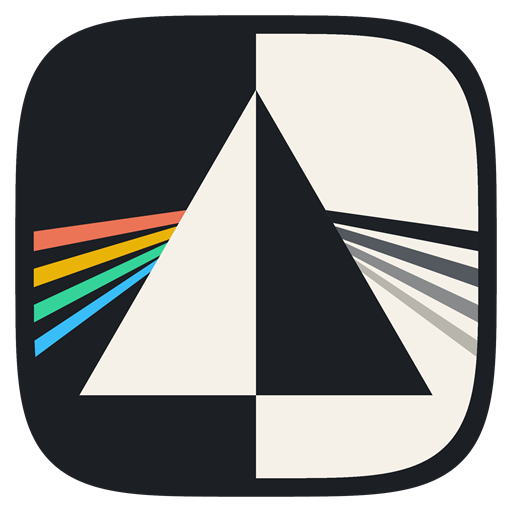
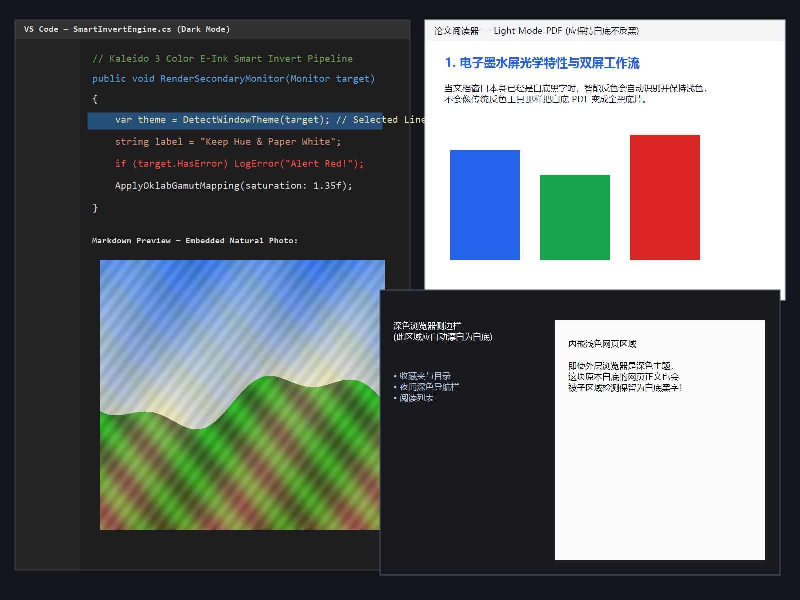
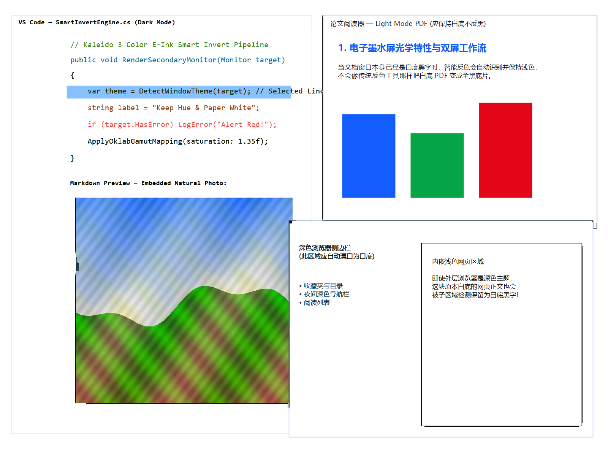
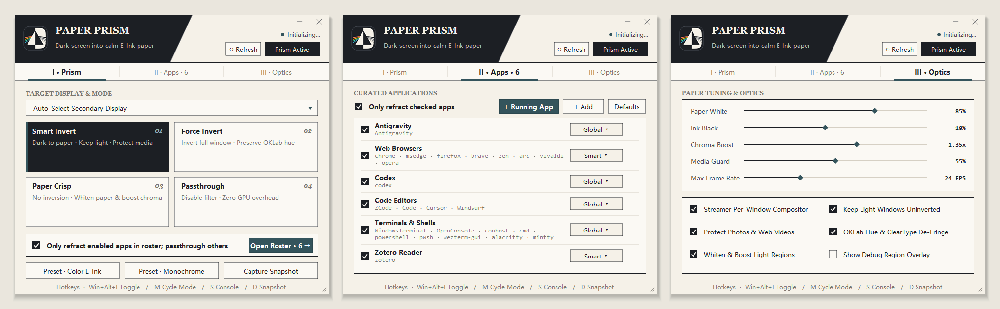
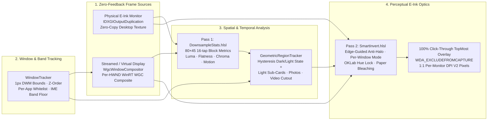

<div align="center">



# PaperPrism

**Dark Screen into Calm E-Ink Paper**  
Per-monitor & per-application GPU Smart Invert engine for Color & Monochrome E-Ink secondary displays on Windows 10/11

[简体中文](README.md) · **English**

[](https://github.com/Zheng-QianChen/PaperPrism/releases)
[-1C1F24)](https://github.com/Zheng-QianChen/PaperPrism)
[](https://dotnet.microsoft.com/download/dotnet/9.0)
[](https://github.com/Zheng-QianChen/PaperPrism)
[](https://github.com/Zheng-QianChen/PaperPrism)
[](LICENSE)

</div>

---

## Why PaperPrism?

Running a **Dark-Mode OLED/IPS primary monitor** alongside a **Color or Monochrome E-Ink secondary monitor** (such as BOOX Mira/Tab, Dasung Paperlike, Bigme, or an E-Ink tablet streamed wirelessly via Sunshine & Moonlight) exposes a painful visual conflict:

- **Your primary screen thrives in Dark Mode** (`#1E1E1E` IDEs, terminals, AI coding assistants), reducing glare during long sessions.
- **E-Ink panels struggle with dark UIs**: dragging dark windows onto an E-Ink screen causes heavy ghosting, sluggish full-page refreshes, low contrast, and muddy Color Filter Array (CFA) grain on Kaleido 3 panels.
- **Naive full-screen inversion breaks everything else**: matrix inverters (`NegativeScreen`, GPU driver toggles, static 3D LUTs) turn **already-white PDFs and web pages pitch black**, turn **photos and web videos into eerie X-ray negatives**, shift syntax colors into unnatural complementary hues, and trigger **infinite flashing feedback loops** on Sunshine/Moonlight virtual displays.

**PaperPrism** acts like an optical prism across your display boundary: your **primary monitor stays 100% untouched in native Dark Mode**, while windows on your E-Ink display pass through a real-time, spatial-aware `Direct3D 11 + HLSL + Windows.Graphics.Capture` pipeline—**dark UIs refract into crisp white paper, light documents stay white, photos and videos stay natural, and syntax hues stay faithful**.

---

## Real GPU Output: Before vs. After

| Raw Dark-Mode Secondary Display (`Before`) | Refracted by PaperPrism (`After`) |
| :---: | :---: |
|  |  |

Six spatial and perceptual mechanisms operate simultaneously within every frame:

1. **Dark-to-Paper & Keep-Light**: Dark IDE windows (`#1E1E1E`) and dark browser chrome transform into crisp `#FFFFFF` paper with `#000000` ink, while **already-light PDF readers** and **embedded white web cards inside dark browsers** stay untouched.
2. **Non-Linear Paper-White Bleaching**: Compresses dark-gray surfaces and faint off-white tints cleanly into pure `#FFFFFF`, eliminating Kaleido 3 CFA dithering noise while preserving subtle semantic highlights like active code selection lines.
3. **OKLab Hue-Preserving Inversion & Kaleido 3 / Carta Tuning**: Inverts lightness strictly inside Björn Ottosson's perceptually uniform **OKLab** color space while locking hue angles (blues stay blue, greens stay green, reds stay red). Supports `0.00x` pure crisp monochrome for **Carta B&W** panels up to `2.50x` chroma compensation for **Kaleido 3 Color E-Ink** panels.
4. **ClearType Subpixel De-Fringing**: Detects 1-pixel subpixel RGB dispersion along glyph stems and suppresses rainbow fringing after lightness inversion.
5. **Photo Protection & Hardware `<video>` Cutout**: Combines 16-tap spatial gradient analysis with inter-frame temporal motion detection—preserving natural illustrations/photos and punching a transparent hardware cutout (`Alpha = 0`) over playing web `<video>` elements for zero negative artifacts.
6. **Clean Premultiplied-Alpha Rounded Popups**: Properly unpremultiplies translucent window borders so Windows 11 rounded context menus and floating popups never exhibit dark rectangular corner halos.

---

## Editorial Borderless Console

Inspired by classic Penguin bookplates and printmaking typography, PaperPrism features a **Windows 11 borderless rounded console** rendered with 100% custom pixel-scaled GDI+ vector controls. It adapts automatically to your system language (pure English or Simplified Chinese) and scales razor-sharply across `100%–300%` Per-Monitor DPI V2 displays:



- **I · Prism**: Choose your target E-Ink display (auto-select secondary monitor or lock to a specific display ID), switch among four optical modes (`Smart Invert`, `Force Invert`, `Paper Crisp`, `Passthrough`), or apply one-click **Color E-Ink (Kaleido 3)** and **Monochrome (Carta)** presets. A persistent **`[ ↻ Refresh ]`** action sits right beside **`[ Prism Active ]`** in the masthead for instant re-scanning.
- **II · Apps (Per-App Whitelist & Independent Modes)**: Ships with curated rules for `Antigravity`, `Web Browsers`, `Code Editors` (`VS Code / Cursor / Windsurf / ZCode`), `Terminals & Shells`, `Codex`, and `Zotero Reader`, plus one-click picking from running desktop windows. When **"Only refract checked apps"** is enabled, unlisted apps bypass WGC frame pool allocation and pixel shading completely—achieving **0 VRAM / 0% GPU native passthrough**.
- **III · Optics**: Fine-tune real-time sliders for **Paper White**, **Ink Black**, **Chroma Boost**, **Media Guard**, and **Max Frame Rate (`5–60 FPS`)**, alongside six low-level optical and debug overlay toggles.

---

## Engineering Highlights for Dual-Screen & Streaming Setups

- **Dual Capture Backends (Physical Monitors + Zero-Feedback Streamers)**
  - **Physical E-Ink Monitors (HDMI / DP / USB-C)**: Uses zero-copy `IDXGIOutputDuplication` paired with `WDA_EXCLUDEFROMCAPTURE`. Inspects `LastPresentTime` so the render loop sleeps at **0% GPU** whenever screen pixels are static (or when only the hardware mouse cursor moves), preventing unnecessary E-Ink refreshes.
  - **Streamed E-Ink Tablets (Sunshine / Apollo + Moonlight)**: Includes a dedicated **`WgcWindowCompositor`** built on `Windows.Graphics.Capture` (`CreateForWindow` COM interop). Instead of capturing the full desktop (which causes infinite flashing feedback loops when streamers capture overlays), PaperPrism composites target `HWND` textures directly in Z-order while leaving the desktop wallpaper and unlisted apps 100% transparent.
- **Silent Standby on Disconnect**: Unplugging an HDMI dummy plug or disconnecting your E-Ink tablet immediately hides the overlay, releases GPU buffers, and enters `0% GPU` standby—**never falling back onto or polluting your primary monitor**—then wakes automatically on reconnect.
- **Native IME Candidate Window Floor Protection**: Queries Win32 `GetWindowBand` to anchor the overlay at the floor of `ZBID_DESKTOP` TopMost windows, keeping Microsoft IME, Sogou, and Rime Weasel candidate popups cleanly **above** the filter without occlusion or double-inversion.
- **Zero NuGet Dependencies**: Written against raw C# P/Invoke and COM vtable bindings for `d3d11.dll`, `dxgi.dll`, `d3dcompiler_47.dll`, and WinRT `Windows.Graphics.Capture`—zero third-party packages, fully offline-buildable.

---

## Comparison with Existing Open-Source Tools

| Tool | License | Core Mechanism | Secondary-Only Lock | Per-App Whitelist & Modes | Keep Light PDFs / Cards | Photo & `<video>` Cutout | OKLab Hue + De-Fringe | Streamer Zero-Feedback |
| :--- | :---: | :--- | :---: | :---: | :---: | :---: | :---: | :---: |
| **NegativeScreen** | MS-PL | Magnification API `5×5` linear matrix | ❌ All screens | ❌ | ❌ Turns PDFs black | ❌ X-ray photos | ❌ Hue shifts | ⚠️ Feedback / global |
| **ShaderGlass** | GPL-3.0 | `WDA_EXCLUDEFROMCAPTURE` + pixel shaders | ✅ | ❌ | ❌ No HWND classification | ❌ | ❌ Retro CRT focus | ⚠️ Full-desktop loop risk |
| **dwm_lut** | GPL-3.0 | `dwm.exe` injection + static 3D LUT | ✅ | ❌ | ❌ Per-pixel LUT only | ❌ | ❌ | ❌ Breaks across Win11 updates |
| **WindowTop** | Freemium / Paid | Per-window dark overlay | ⚠️ Manual per window | ⚠️ Manual | Paid tier only | Paid tier only | ❌ Not E-Ink tuned | ⚠️ |
| **PaperPrism** | **MIT** | **D3D11 + HLSL + HWND Tracking + Per-Window WGC** | **✅ Native lock + standby** | **✅ Zero-cost whitelist + per-app modes** | **✅ Window + sub-card preservation** | **✅ Gradient guard + video cutout** | **✅ OKLab + Kaleido 3 / Carta presets** | **✅ Native per-window WGC** |

---

## Rendering Architecture



---

## Quick Start

### System Requirements

- **OS**: Windows 10 `2004` (Build 19041+) or **Windows 11 (`x64`)**
- **Runtime**: [.NET 9.0 Desktop Runtime (x64)](https://dotnet.microsoft.com/download/dotnet/9.0)

### Option A: Download Portable Release ZIP (Recommended)

1. Download `PaperPrism-v1.0.0-win-x64.zip` from [**GitHub Releases**](https://github.com/Zheng-QianChen/PaperPrism/releases).
2. Extract to any folder and launch **`PaperPrism.exe`**.
3. The console opens automatically on first launch and lives in your system tray. Settings are stored portably in `settings.local.json` next to the executable with zero registry footprint.

### Option B: Build & Run GPU Self-Tests from Source

With zero external NuGet dependencies, installing the [.NET 9.0 SDK](https://dotnet.microsoft.com/download/dotnet/9.0) is all you need to compile offline and run the 9-check automated GPU/WGC/IME/Per-App verification suite:

```powershell
git clone https://github.com/Zheng-QianChen/PaperPrism.git
cd PaperPrism

# Build Release, execute all 9 GPU & window-band self-tests, and publish to publish/
powershell -ExecutionPolicy Bypass -File .\build.ps1 -SelfTest -Publish

# Launch PaperPrism
.\publish\PaperPrism.exe
```

### Global Hotkeys

| Hotkey | Action |
| :--- | :--- |
| `Win + Alt + I` | Toggle refraction On / Passthrough (hides overlay completely at 0% GPU when paused) |
| `Win + Alt + M` | Cycle global mode: `Smart Invert` → `Force Invert` → `Paper Crisp` → `Passthrough` |
| `Win + Alt + S` | Open or focus the PaperPrism console |
| `Win + Alt + D` | Capture diagnostic snapshot (`raw`, `mask`, and `refracted` PNGs saved to `snapshots/`) |

---

## E-Ink Tablet Streaming Guide (Sunshine + Moonlight)

If you use a **BOOX tablet, Android E-Ink slate, or iPad** as a wireless secondary display via **Sunshine (or Apollo) + Moonlight**, these practices deliver the cleanest experience:

1. **Prefer a Hardware HDMI 2.1 Dummy Plug over Software `IddCx` Drivers**  
   An inexpensive (`$5`) physical HDMI/DP dummy plug connected to a spare GPU port provides real hardware scanout, rock-solid stability across Windows updates, and effortless custom `4:3` high-DPI resolutions (`2048×1536 @ 200%` or `3200×2400 @ 300%`).
2. **Pin Your Secondary Display in Chapter I (`Prism`)**  
   Select the specific display device instead of leaving it unbound if you frequently disconnect it; PaperPrism will enter silent `0% GPU` standby whenever the display is offline without touching your main screen.
3. **Keep "Streamer Per-Window Compositor" Checked**  
   Enabled by default in Chapter III (`Optics`), this uses per-window WinRT WGC capture so Sunshine streams crisp refracted windows with zero capture feedback loops.
4. **Recommended Panel Tuning**
   - **Kaleido 3 Color E-Ink**: Click `Preset · Color E-Ink` (`Paper White 80%–85%`, `Ink Black 18%–25%`, `Chroma Boost 1.35x–2.20x` depending on your tablet's refresh mode).
   - **Carta 1200 / 1300 Monochrome**: Click `Preset · Monochrome` (`Chroma Boost = Mono 0.00x` for razor-sharp pure grayscale).
   - **Max Frame Rate**: `24–30 FPS` balances smooth scrolling with minimal power draw.

---

## Project Layout

```text
PaperPrism/
├── assets/                                  # Prism vector icon & CN/EN borderless UI overviews
├── docs/images/                             # Real GPU before/after multi-window renders
├── build.ps1                                # One-step build, 9-check GPU self-test & publish script
├── PaperPrism.sln                           # Visual Studio / .NET 9 solution
└── src/EInkSmartInvert/
    ├── Assets/app.ico                       # Supersampled optical prism multi-size icon
    ├── Config/AppSettings.cs                # Portable JSON settings, app rules & E-Ink presets
    ├── Core/
    │   ├── MonitorManager.cs                # Physical pixel display enumeration & standby logic
    │   ├── WindowTracker.cs                 # 1px DWM bounds, PID cache & IME Z-band floor detection
    │   ├── GeometricRegionTracker.cs        # Hysteresis window state + sub-card/photo/video cutout
    │   └── OverlayEngine.cs                 # Click-through overlay, dual backends & 0%-idle loop
    ├── Graphics/
    │   ├── D3D11Interop.cs                  # Zero-dependency D3D11 / DXGI 1.2 / D3DCompiler bindings
    │   ├── WgcWindowCompositor.cs           # Per-window WinRT Windows.Graphics.Capture compositor
    │   ├── GpuSmartInvertPipeline.cs        # Two-pass HLSL compiler & GPU pipeline scheduler
    │   └── Shaders/
    │       ├── DownsampleStats.hlsl         # Pass 1: 80×45 16-tap luma/flatness/chroma/motion stats
    │       └── SmartInvert.hlsl             # Pass 2: Per-window mode, OKLab hue lock & de-fringing
    ├── Diagnostics/SyntheticSelfTest.cs     # Automated 9-check GPU, video cutout, WGC & IME suite
    └── UI/                                  # Win11 borderless editorial GDI+ console & tray hotkeys
```

---

## License

Released under the [MIT License](LICENSE). Contributions, issues, and pull requests are welcome!
